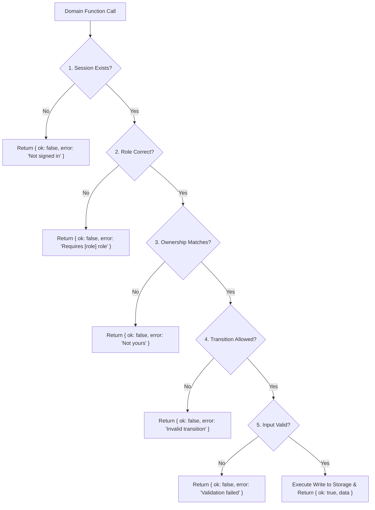

# Halo Authentication & Access Control (AUTH.md)

This document describes the authentication mechanisms, role-based access control (RBAC), guarded write workflows, and security boundaries implemented in Halo.

---

## 1. Demo Session Storage Architecture (Hard Rule 1)

Halo is an architectural prototype built without an external backend. In strict compliance with **Hard Rule 1**:
- **No Passwords or Secrets:** Passwords, API tokens, and payment secrets are **never** stored.
- **Session Persistence:** Active user authentication state is persisted in the browser's `sessionStorage` under the key:
  `halo_session_v1`
- **Session Object Structure:**
  ```json
  {
    "userId": "00000000-0000-4000-a000-000000000002",
    "name": "Meron Tadesse",
    "email": "meron@blight.demo",
    "roles": ["owner"]
  }
  ```
- **Lifecycle:** The session is scoped to the browser tab session. Calling `signOut()` purges `halo_session_v1` and any active checkout draft in `halo_checkout_draft_v1`, redirecting the user safely to the landing page.

---

## 2. Role-Based Access Control (RBAC)

Halo defines three explicit roles:

| Role | Permissions & Access Scope |
|------|----------------------------|
| **`renter`** | Public browsing, studio/equipment booking, quote requests, customer dashboard (`/dashboard`), cancellation of own bookings, review submission, and opening disputes. |
| **`owner`** | Management of own provider storefront (`/owner/provider`), portfolio media, listings catalog, buffer settings, incoming requests, quote composer, calendar, reviews, and earnings. Users may hold dual roles (e.g. `roles: ['owner', 'renter']`). |
| **`admin`** | Platform-wide moderation of providers and listings, account suspension/reinstatement, dispute mediation, commission reporting, and announcements broadcasting. **Public signup can never choose or grant the admin role.** |

### Account Status & Suspensions
User records maintain a `status` field: `'active'` or `'suspended'`.
- If an account is marked `'suspended'`, `signInAsDemo` rejects authentication with `"This account has been suspended"`.
- If a session is suspended, `RequireRole.js` renders an explicit **Access Blocked** banner and domain functions reject all write operations.

---

## 3. Safe Return Path Navigation (`safeReturnPath`)

To prevent open-redirect vulnerabilities when redirecting users after authentication:
```javascript
export function safeReturnPath(value) {
  // Rejects null, non-strings, double slashes (//evil.com), backslashes (/\evil.com), and external schemes (https://)
  // Ensures redirect is constrained to the same origin; defaults to '/'
}
```
All query string redirects (e.g. `/signin?next=/checkout`) pass through `safeReturnPath()` before `router.push()` is invoked.

---

## 4. Guarded Writes Pattern (Hard Rule 3)

UI visibility is never treated as security. Every write operation in `lib/domain/` enforces a strict 5-tier guard order:



---

## 5. Security Disclaimer (Hard Rule 7)

> [!WARNING]
> **Truthful Documentation Notice:**
> The authentication and authorization mechanisms documented here are **frontend demo simulations** designed for capstone evaluation.
>
> In a production environment:
> 1. Authentication must be managed server-side using secure HTTP-only cookies, signed JWTs, or session tokens.
> 2. Passwords must be hashed using `bcrypt` or `argon2`.
> 3. Authorization rules and role validations must execute on an authenticated API or database layer (e.g., PostgreSQL Row-Level Security).
> 4. Client-side storage (`localStorage`/`sessionStorage`) is inherently vulnerable to cross-site scripting (XSS) and client tampering, and must never hold sensitive financial or credential data in production.
